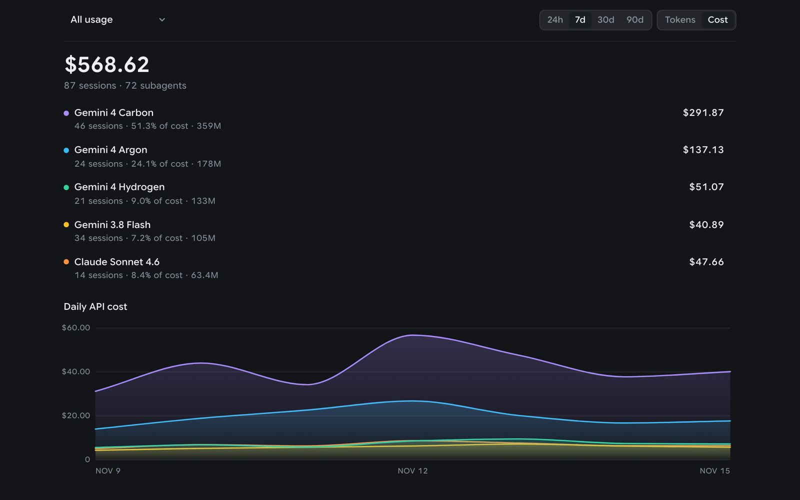

# Usage for Antigravity

Track processed tokens, standard API-equivalent costs, prompt cache savings, and per-project or per-model breakdowns inside a native Antigravity sidecar panel.

> Forked from [ahmetdotsh/agy-usage](https://github.com/ahmetdotsh/agy-usage). All core architecture and major features—including the zero-token local SQLite & protobuf telemetry reader, LiteLLM live pricing sync, API-equivalent cost & prompt cache savings calculation, interactive 7-day stacked chart, workspace/surface scoping, and the native Antigravity sidecar UI—are credited to the original repository.
>
> This fork adds local model family classification and standard rate table support for **Gemini 4 Neon** (`gemini-4-neon` and `gemini-pro-orchestrator-neon`).



## Install

```bash
agy plugin install https://github.com/acdc-awa/agy-usage
```

## Features

- **Tokens & Cost modes**: Switch instantaneously between total processed tokens and standard API-equivalent spend, plus cumulative prompt cache savings.
- **Interactive 7-day stacked chart**: Scrub across days for exact daily breakdowns and click any model family in the legend to solo its trend line.
- **Native workspace & surface scoping**: Filter by all usage, current conversation, specific workspace projects, Desktop app, or CLI.
- **Model & Session breakdown**: Expand any model row for per-1M rate details and cached/uncached/output splits, or switch to the Session tab for recent runs.
- **Zero-token local analytics**: Computes usage directly from local Antigravity state with automatic pricing metadata caching.

## Usage

Open the panel using the sidecar `+` button (`Usage`) or ask Antigravity:

> Open the Usage panel

## License

[MIT](LICENSE)
